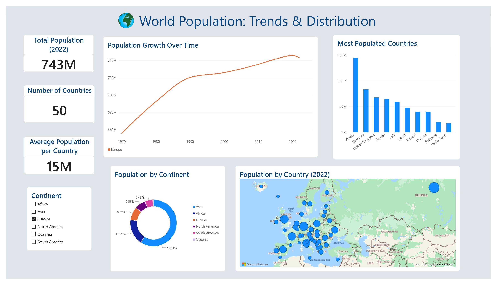

# World Population: Trends & Distribution Dashboard

An interactive Power BI dashboard analyzing global population metrics, demographic distribution across continents, and historical growth trends from 1970 to 2022.

---

## 📌 Project Overview
This project visualizes global population data to provide clear insights into population density, growth over time, and regional breakdowns. It is designed to allow seamless dynamic filtering across continental and country levels using interactive visual elements. The source data is from kaggle, script to download is included.

---

## 📊 Key Features & Visualizations
* **KPI Summary Cards:** Displays key metrics dynamically updated based on user selections:
  * Total Population
  * Number of Countries
  * Average Population per Country
* **Population Growth Over Time (Line Chart):** Analyzes historical population trajectories (1970–2022) filtered dynamically by continent or country.
* **Most Populated Countries (Bar Chart):** Ranks countries by total population size with interactive cross-filtering.
* **Population by Continent (Donut Chart):** Visualizes the percentage distribution of global population across continents.
* **Population by Country Map:** Interactive spatial representation mapping geographical population density across regions.
* **Continent Slicer:** Allows easy multi-region filtering without losing visual context.

---

## 🛠️ Tools & Technologies Used
* **Power BI Desktop:** Dashboard design, data visualization, and interaction modeling.
* **Git & GitHub:** Version control and portfolio documentation.

---

## 📁 Repository Structure

```text
powerbi-report/
├── data/
│   └── world_population.csv
├── images/
│   ├── report_screenshot.jpg
│   └── world_earth_logo.png
├── report/
│   └── tarea2_powerBI_Randall_Hidalgo.pbix
├── scripts/
│   └── import_kagglehub.py
└── README.md
```

## 🖼️ Dashboard Preview

The screenshot below shows the completed report canvas. Open the `.pbix` file in Power BI Desktop to interact with the slicer and visuals.


